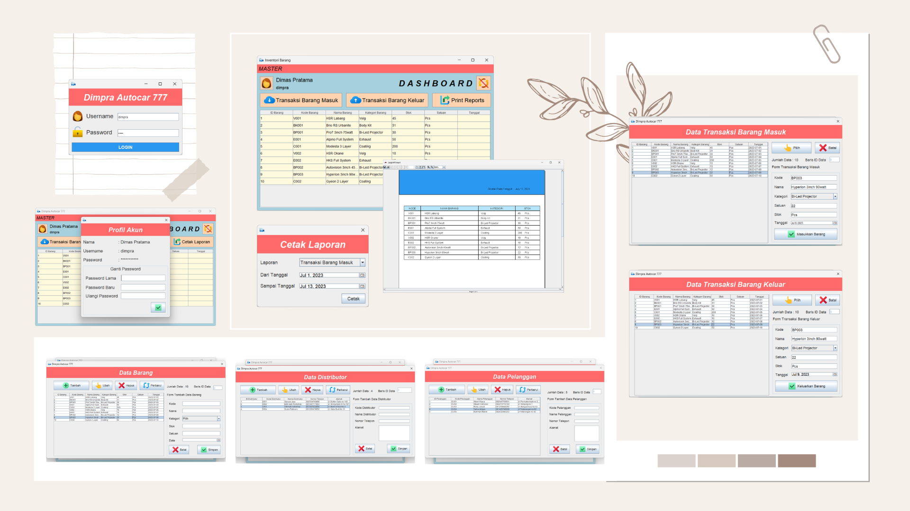

# Car Workshop Inventory

[](https://openjdk.org/)
[-orange?logo=openjdk&logoColor=white)](https://openjdk.org/)
[-5382A1?logo=java&logoColor=white)](https://docs.oracle.com/javase/tutorial/uiswing/)
[](https://en.wikipedia.org/wiki/Client%E2%80%93server_model)
[](https://www.mysql.com/)
[](https://community.jaspersoft.com/)
[](https://www.mindrot.org/projects/jBCrypt/)
[](https://ant.apache.org/)
[](./LICENSE)

<p align="center">
  
</p>

Car Workshop Inventory (**Inventori Barang**) is a robust desktop warehouse and spare parts inventory management application built with Java Swing and MySQL. Engineered specifically for automotive repair workshops, parts distributors, and maintenance centers, the system addresses the operational challenges of tracking stock levels, warehouse shelf/rack allocations, supplier procurement, and customer sales disbursements within a single consolidated desktop interface.

The application features role-governed staff authentication secured with OpenBSD BCrypt hashing, comprehensive master data records for items, categories, suppliers, customers, and employees, as well as automated two-way inventory transaction logging (inbound restocking and outbound distribution). Integrated with the JasperReports reporting engine and rs2xml tabular data binding, the software delivers instantaneous stock balance audits, periodic movement summaries, and printable receipt and invoice documents directly to workshop managers and operational personnel.

---

## Features

- **Staff Authentication & Session Management**:
  - Secure login interface verifying credentials against MySQL user records.
  - Active/inactive account status enforcement preventing disabled personnel from accessing workshop systems.
  - In-app profile manager allowing staff to inspect credentials and update passwords with old-password verification and BCrypt encryption.
  - Global session tracker (`PetugasSession`) passing authenticated identity, operator names, and privileges to transaction forms and audit stamps.

- **Warehouse Master Data Management (CRUD)**:
  - **Item Catalog (`Frmbarang`)**: Complete management of inventory spare parts including unique item code, title, category classification, unit of measurement (e.g., pieces, units, sets), and real-time stock balance.
  - **Category & Rack Allocation (`FrmbarangKategori`)**: Physical warehouse organization linking item categories directly to assigned warehouse shelf/rack numbers (`no_rak`).
  - **Supplier Directory (`Frmsupplier`)**: Vendor management storing vendor code, company name, representative contact numbers, and physical workshop delivery addresses.
  - **Customer Registry (`Frmpelanggan`)**: Client records tracking customer codes, organization or owner names, phone numbers, and delivery addresses.
  - **Officer / Personnel Administration (`Frmpetugas`)**: Internal user administration enabling registration, profile updates, account activation toggling, and credential resets.

- **Transactional Stock Operations**:
  - **Inbound Stock Procurement (`FrmtransaksiMasuk`)**: Handles incoming stock deliveries from registered suppliers, dynamically adds multiple line items into an active staging table, records transaction headers, and automatically increments inventory stock counts in `tmbarang`.
  - **Outbound Stock Disbursement (`FrmtransaksiKeluar`)**: Processes item issuances and parts sales to customers, verifies real-time stock availability to prevent overselling, decrements quantity counts, and registers outbound audit records.
  - **Automated Rollback & Transaction Integrity**: Validates line-item counts and rolls back empty or invalid transaction headers to maintain database consistency.

- **Document Generation & Reporting Engine (JasperReports)**:
  - **Inventory Balance Report (`report_barang.jrxml`)**: Instant printable stock ledger displaying item codes, descriptions, rack locations, quantities, and units.
  - **Periodic Inbound Report (`report_barangMasuk.jrxml`)**: Date-range filtered report summarizing all received parts and supplier shipments.
  - **Periodic Outbound Report (`report_barangKeluar.jrxml`)**: Date-range filtered report summarizing client deliveries and workshop parts consumption.
  - **Transaction Invoices & Receipts (`report_transaksiMasuk.jrxml`, `report_transaksiKeluar.jrxml`)**: Instant printable transaction receipts generated immediately upon transaction submission.

- **Operational UI & Interactive Dashboard**:
  - Centralized dashboard featuring an instant-load tabular view of all catalog items and remaining stock.
  - Modal dialogue windows centered automatically on screen with standardized color schemes and branded headers.
  - Quick-action toolbar buttons facilitating rapid one-click navigation to inbound intake, outbound distribution, and report generation workflows.

---

## Platform Support

| Operating System | Configured Target | Tested Status | Distribution Artifact |
| :--- | :---: | :---: | :--- |
| **Windows** (10 / 11, x86/x64) | Yes | Verified on Windows 10/11 x64 | Executable JAR (`dist/inventori_barang.jar`) |
| **macOS** (Intel / Apple Silicon) | Yes | Supported via JRE 8+ / OpenJDK 8+ | Executable JAR (`dist/inventori_barang.jar`) |
| **Linux** (x86_64, ARM64) | Yes | Supported via JRE 8+ / OpenJDK 8+ | Executable JAR (`dist/inventori_barang.jar`) |

> [!NOTE]
> The application runs on any desktop platform equipped with a standard Java Runtime Environment (JRE 8 or later) with AWT/Swing graphical display capabilities.

---

## Tech Stack

- **Core Runtime & Language**: Java SE 8 (`javac.source=1.8`, `javac.target=1.8`), Oracle OpenJDK 8.0 / Adoptium Temurin 8+.
- **User Interface & Presentation**:
  - Java Swing & Abstract Window Toolkit (AWT)
  - Swing Nimbus Look and Feel (`javax.swing.UIManager`)
  - NetBeans AbsoluteLayout (`AbsoluteLayout.jar`)
  - JCalendar 1.4 (`jcalendar-1.4.jar` / `com.toedter.calendar.JDateChooser`)
- **Database & Data Binding**:
  - MySQL Database Server (5.7 / 8.0)
  - MySQL Connector/J 8.0 (`mysql-connector-java-8.0.21.jar` / `com.mysql.cj.jdbc.Driver`)
  - rs2xml (`rs2xml.jar` / `net.proteanit.sql.DbUtils`) for dynamic SQL `ResultSet` to `TableModel` transformation
- **Document & Reporting Framework**:
  - JasperReports 5.6.0 (`jasperreports-5.6.0.jar`)
  - iText 2.1.7 (`itext-2.1.7.jar`) for PDF compilation and document export
  - Apache Commons Digester 1.8 (`commons-digester-1.8.jar`)
  - Apache Commons Collections 3.2.1 (`commons.collections-3.2.1.jar`)
  - Apache Commons BeanUtils 1.8.2 (`commons-beanutils-1.8.2.jar`)
  - Apache Commons Logging 1.1 (`commons-logging-1.1.jar`)
  - Apache Commons Javaflow 20060411 (`commons-javaflow-20060411.jar`)
  - Groovy Runtime 1.7.5 (`groovy-all-1.7.5.jar`)
- **Cryptography & Security**:
  - jBCrypt (`org.mindrot.jbcrypt.BCrypt`) with OpenBSD Blowfish password hashing
- **Build & Project System**:
  - Apache Ant (`build.xml`)
  - NetBeans Project Format (`nbproject`)

---

## Prerequisites

### For End Users & Workshop Operators
- **Java Runtime Environment (JRE)**: JRE 8 (1.8) or higher installed and accessible on system path (`java -version`).
- **Database Connectivity**: Network access or local installation of MySQL Server (version 5.7, 8.0, or MariaDB 10+).

### For Software Developers
- **Java Development Kit (JDK)**: JDK 8 (e.g., Eclipse Temurin 8, Oracle JDK 8, or Amazon Corretto 8).
- **Build Tool**: Apache Ant 1.9+ (or an integrated IDE such as NetBeans IDE 8.2+, Apache NetBeans 12+, or IntelliJ IDEA with Ant plugin).
- **Database Server**: Local MySQL server (standalone or bundled via XAMPP / WampServer / Docker).

---

## Installation & Setup

### 1. Acquire the Repository
Clone the repository to your local workstation:

```bash
git clone https://github.com/weztcy/Car-Workshop-Inventory.git
cd "Car Workshop Inventory"
```

### 2. Configure the MySQL Database
1. Ensure your MySQL server service is active on standard port `3306`.
2. Connect to the MySQL shell or phpMyAdmin and create the target database:
   ```sql
   CREATE DATABASE inventori;
   ```
3. Import the complete workshop schema and initial seed data from `./database/inventori.sql`:
   ```bash
   mysql -u root -p inventori < database/inventori.sql
   ```

### 3. Verify Database Credentials
The application establishes connections via `src/inventori_barang/koneksi.java`. If your local MySQL instance utilizes a custom password or host, adjust the connection parameters prior to rebuilding:

```java
String connURL = "jdbc:mysql://localhost:3306/inventori?autoReconnect=true&useSSL=false"
        + "&useUnicode=true&useJDBCCompliantTimezoneShift=true&useLegacyDatetimeCode=false&serverTimezone=UTC";
String user = "root";
String password = ""; // Specify your database password here if applicable
```

---

## Environment Variables & Configuration

The application utilizes direct JDBC configuration properties embedded within `src/inventori_barang/koneksi.java`:

| Parameter | Default Value | Description |
| :--- | :--- | :--- |
| **Driver** | `com.mysql.cj.jdbc.Driver` | Modern MySQL Connector/J driver class |
| **Host** | `localhost` | MySQL database host or workshop LAN IP address |
| **Port** | `3306` | Default TCP port for MySQL service |
| **Database** | `inventori` | Schema name containing workshop tables |
| **User** | `root` | Database username credential |
| **Password** | *(empty string)* | Database user password |
| **Connection Flags** | `autoReconnect=true&useSSL=false` | Ensures persistent connectivity without requiring SSL certificates |
| **Timezone** | `serverTimezone=UTC` | Avoids JDBC driver timezone discrepancies |

---

## Usage / Getting Started

### Launching the Pre-Built Application
Run the packaged JAR from the repository's `dist/` directory:

```bash
cd dist
java -jar "inventori_barang.jar"
```

### First-Run Authentication Flow
1. Upon startup, the **Login Petugas** dialog appears.
2. Enter the active staff credentials provisioned in `database/inventori.sql`:
   - **Username**: `rinaldi`
   - **Password**: *(enter password configured during account setup)*
3. Click **Masuk** (or press `Enter` from the password field).
4. Upon successful validation, the primary **Dashboard** interface opens displaying registered user details and current inventory levels.

### Key Operational Workflows
- **Receive Stock (Barang Masuk)**:
  1. Click the **Barang Masuk** button on the dashboard or select `Transaksi` -> `Barang Masuk`.
  2. Select the vendor from the supplier dropdown menu.
  3. Enter the spare part item code in `txtkode_barang` and specify the incoming quantity.
  4. Click **OK** to stage the item into the transaction list.
  5. Click **Simpan** to commit the transaction, update physical inventory stock counts, and generate the inbound receipt.
- **Disburse Stock (Barang Keluar)**:
  1. Click **Barang Keluar** or navigate to `Transaksi` -> `Barang Keluar`.
  2. Select the destination customer / repair client.
  3. Enter the item code and requested issuance quantity (validated against current stock availability).
  4. Submit to update inventory levels and print delivery documentation.
- **Generate Management Reports**:
  1. Click **Cetak Laporan** on the dashboard.
  2. Select the desired report type:
     - `Persedian Barang`: Full inventory catalog ledger.
     - `Barang Masuk`: Filter by start date (`Dari Tanggal`) and end date (`Sampai Tanggal`).
     - `Barang Keluar`: Filter by start date (`Dari Tanggal`) and end date (`Sampai Tanggal`).
  3. Click **Cetak** to launch the JasperViewer window with print and PDF export capabilities.

---

## Available Scripts / Commands

If building and maintaining the project from the command line using Apache Ant:

| Command | Action |
| :--- | :--- |
| `ant compile` | Compiles all Java source files into `build/classes/` |
| `ant jar` | Packages the application and copies classpath dependencies to `dist/` |
| `ant run` | Compiles (if modified) and launches the main application (`inventori_barang.FrmloginPetugas`) |
| `ant clean` | Deletes build artifacts and removes generated classes in `build/` |
| `ant clean jar` | Performs a clean rebuild, generating a fresh distribution JAR in `dist/` |

---

## Permissions & Device Requirements

- **Network Socket Access**: Outbound TCP communication on port `3306` to connect to local or remote MySQL instances.
- **Local File System I/O**: Read permissions for embedded UI assets (`src/inventori_barang/img/`) and JasperReports template definitions (`src/report/*.jrxml` / `*.jasper`).
- **Printer & Document Spooling**: Operating system print queue access when invoking direct print commands via JasperViewer.

---

## Data Storage & Synchronization

All application records are persisted in a relational MySQL database. The database architecture is structured into master entities and transactional journal tables:

- **Master Tables**:
  - `tmbarang`: Primary inventory master storing code, name, category foreign key, unit, and current quantity on hand.
  - `tmkategori`: Category classifications coupled with physical storage rack numbers.
  - `tmsupplier`: Registered parts suppliers and distributor contacts.
  - `tmpelanggan`: Customers and corporate client entities.
  - `tmpetugas`: System user accounts, authorization status (`aktif` / `nonaktif`), and BCrypt password digests.
- **Transaction Journal & Detail Tables**:
  - `trbarang_masuk` & `trbarang_masuk_detail`: Inbound restocking history tracking supplier ID, timestamp, operator ID, and itemized line quantities.
  - `trbarang_keluar` & `trbarang_keluar_detail`: Outbound distribution history logging recipient client ID, timestamp, operator ID, and disbursed quantities.
- **Synchronization Model**:
  - Operates as a centralized client-server database model. Multiple workshop terminals running `inventori_barang.jar` on the local area network (LAN) can connect simultaneously to a shared MySQL server instance to maintain unified stock counts in real time.

---

## Build & Packaging

The distribution package is generated through the Apache Ant build configuration:

1. Execute the build command from the project root:
   ```bash
   ant jar
   ```
2. Ant compiles the source tree, processes resources, and outputs:
   - `dist/inventori_barang.jar`: The executable application archive with pre-configured manifest `Class-Path` entries.
   - `dist/lib/`: All required external libraries (`AbsoluteLayout.jar`, `jasperreports-5.6.0.jar`, `mysql-connector-java-*.jar`, `jcalendar-1.4.jar`, `rs2xml.jar`, and Apache Commons modules).
3. **Distribution Requirement**: When deploying to user workstations, copy the entire `dist/` folder together (preserving the `lib/` subfolder adjacent to `inventori_barang.jar`).

---

## License

Please see the [LICENSE](./LICENSE) file for the terms and conditions governing the use, modification, and distribution of this project.

---

## Author & Contact

**Yohanes Dimas Pratama**

- GitHub: [github.com/weztcy](https://github.com/weztcy)
- Portfolio: [dimaspratama.vercel.app](https://dimaspratama.vercel.app)
- LinkedIn: [linkedin.com/in/yohanes-dimas](https://www.linkedin.com/in/yohanes-dimas)

